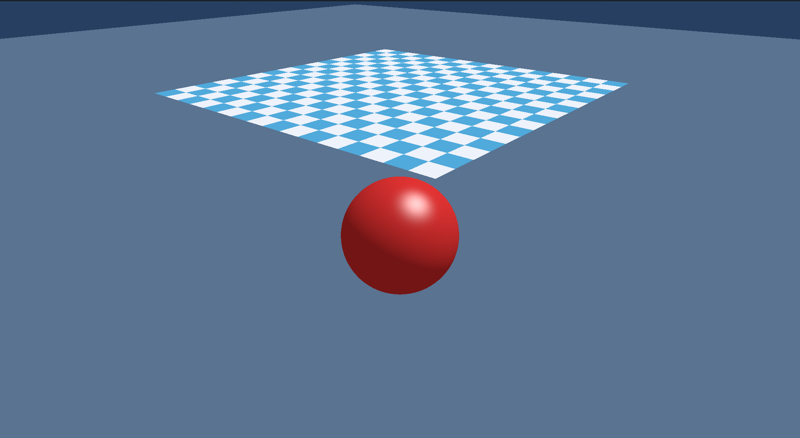

# wgpu Part 3: GPU Cloth Simulation (Starter)


The starter project for **Part 3** of the wgpu series. It draws the whole scene (a sphere, a ground plane and a 128 × 128 cloth), but the cloth is frozen in the air. In the video, you'll write the compute shaders that bring it to life.

> **Watch the video:** https://youtu.be/0R-nBk1PbF4
> **Finished code:** https://github.com/CodynnYT/wgpu-cloth-simulation.git



## What's already done

- Window, event loop and mouse orbit camera (from Part 2)
- A red sphere and a ground plane, drawn as ordinary meshes
- A 128 × 128 grid of cloth particles stored in a **storage buffer**
- A cloth vertex shader that reads particle positions straight from that buffer, with no vertex buffer
- Normals calculated from neighbouring particles, so lighting still works as the cloth changes shape
- A checker pattern on the cloth, so stretching is easy to see
- Solid and net (wireframe) views of the cloth
- Two copies of the particle buffer and a `current` index, ready for ping-ponging
- Reset and FPS counter

## What you'll add

- `sim.wgsl`, a new file containing two compute shaders: `integrate` and `constraints`
- A previous-position buffer for Verlet integration
- A uniform buffer with the simulation settings
- Bind groups that ping-pong between the two particle buffers
- Compute pipelines and a compute pass recorded before the render pass
- A fixed timestep with substeps
- Structural, shear and bend springs
- Sphere and ground collisions with friction
- Pause, and a full reset

## Getting started

### Prerequisites

- [Rust](https://rustup.rs) (edition 2024, so a recent stable toolchain)
- A GPU with a Vulkan, Metal or DirectX 12 driver

### Run

```bash
git clone <this-repo-url>
cd <repo-folder>
cargo run --release
```

You should see the sphere, the ground, and a flat sheet of cloth hanging still above them. That's expected: nothing updates the particles yet.

### Controls

| Input | Action |
|---|---|
| Hold left mouse button and move the mouse | Orbit the camera |
| V | Switch between solid and net view |
| R | Reset the cloth |
| Close the window | Quit |

## Project structure

| File | Responsibility | Changed in Part 3? |
|---|---|---|
| `src/main.rs` | Window and event loop. Passes input to `State` | No |
| `src/state.rs` | Owns every GPU object. Setup, `update` and `render` | Yes, most of the Rust |
| `src/config.rs` | Grid, cloth, sphere and pin settings | Yes, physics settings |
| `src/render.wgsl` | Draws the sphere, ground and cloth | No |
| `src/sim.wgsl` | The simulation (compute shaders) | **New file** |

## Settings

| Constant | Default | Meaning |
|---|---|---|
| `GRID_N` | 128 | Particles along each side of the cloth |
| `CLOTH_SIZE` | 5.0 | Width of the cloth in world units |
| `CLOTH_HEIGHT` | 2.5 | Starting height of the cloth |
| `CLOTH_TILT_DEG` | 0.0 | Starting tilt of the cloth |
| `PIN_MODE` | 0 | 0 = nothing pinned, 1 = four corners, 2 = top two corners |
| `SPHERE_RADIUS` | 1.0 | Radius of the sphere |
| `NET_STRIDE` | 4 | Draw every Nth row and column in net view |

## Prerequisite parts

- **Part 1, Your First Triangle:** [LINK]
- **Part 2, Textured Cubes, Camera and Instancing:** [LINK]

Part 2 covers the camera, depth buffer, bind groups and lighting used here.

## License

See the `LICENSE` file in the repository root.